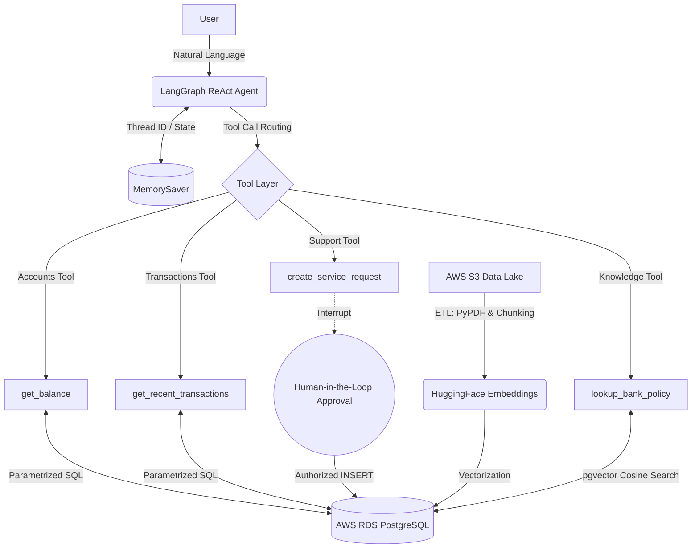

# 🏦 NexusBank AI: Autonomous Cloud-Connected Banking Agent


An enterprise-grade, stateful AI banking agent built with **LangGraph** and **Python**. Unlike standard chatbots that just answer FAQs, this agent combines structured deterministic data handling (SQL) with unstructured knowledge retrieval (Agentic RAG). It autonomously routes user intent to execute dynamic SQL queries against a live AWS cloud ledger, fetches regulatory documents streamed from an AWS S3 data lake, and implements Human-in-the-Loop (HITL) safeguards for transactional operations.

---

## 🏗 System Architecture

The project follows a decoupled, microservice-inspired architecture separating the LLM reasoning loop, the database execution layer, and the vector embedding pipeline.



### 🧠 The Core Components

1. **The Brain (LLM Layer):** Utilizes LangGraph's `create_react_agent` to manage the conversation flow. The LLM (Nemotron via OpenRouter) evaluates its current context and autonomously decides which tools to invoke.
2. **The Memory (State Layer):** Implements LangGraph's `MemorySaver` using unique UUIDs. This provides session-based short-term memory, meaning users don't have to repeat parameters in follow-up questions.
3. **The Body (Tool Layer):** Decoupled Python functions decorated with LangChain's `@tool`. Each tool is tightly scoped to a specific database domain (Accounts, Transactions, Support, Knowledge).
4. **The Knowledge (RAG Layer):** An automated ETL pipeline streams raw regulatory PDFs from an **AWS S3** bucket, chunks them, embeds them via HuggingFace (`all-MiniLM-L6-v2`), and indexes them in PostgreSQL using the `pgvector` extension for instant cosine-similarity searches.
5. **The Infrastructure (Data Layer):** A live AWS RDS PostgreSQL database enforcing `sslmode=require`. Queries are heavily parameterized using `psycopg2` to eliminate SQL injection vulnerabilities.

---

## ✨ Granular Features

* **Agentic RAG:** The LLM doesn't blindly inject documents into every prompt. It autonomously decides when to invoke the `lookup_bank_policy` tool, mathematically searches the `pgvector` database, and cites the exact `s3://` object URI in its response.
* **Intelligent Tool Routing:** The agent parses natural language and autonomously binds variables to Python functions (e.g., mapping "How much did I spend at Whole Foods?" to `get_recent_transactions(account_id="...", limit=5)`).
* **Human-in-the-Loop (HITL) Safeguards:** Read operations happen instantly, but write operations (`INSERT`/`UPDATE`) physically pause the application thread. The agent cannot open a financial dispute without a human explicitly typing `y` in the terminal to authorize the database `commit()`.
* **Strict SOP Enforcement:** The agent is governed by a robust system prompt. For example, it is explicitly forbidden from opening a dispute ticket until it (1) fetches the merchant/amount from the ledger, and (2) queries the S3 policy manual to ensure the dispute is legally eligible.

---

## 📂 Project Structure

```text
banking-agent/
├── data/
│   └── banking_corpus/      # Local staging for downloaded regulatory PDFs
├── src/
│   ├── config/
│   │   └── settings.py      # Centralized LLM factory and environment init
│   ├── db/
│   │   ├── database.py      # AWS psycopg2 connection manager & schema init
│   │   ├── seed_realistic.py# Data injection for mock transaction ledgers
│   │   ├── download_corpus.py# Automatically fetches real-world bank manuals
│   │   ├── upload_to_s3.py  # Pushes raw PDFs to AWS S3 Data Lake
│   │   └── seed_from_s3.py  # ETL: Streams S3 -> Chunks -> Embeds -> pgvector
│   └── tools/
│       ├── accounts.py      # Read-tool: SQL logic for balance lookups
│       ├── transactions.py  # Read-tool: SQL logic for historical ledgers
│       ├── support.py       # Write-tool: SQL logic for tickets (HITL)
│       └── knowledge.py     # RAG-tool: Cosine similarity search via pgvector
├── .env                     # Ignored: Contains AWS and LLM API Keys
├── agent.py                 # Core LangGraph execution loop and CLI interface
└── requirements.txt         # Python dependencies

```

---

## 🚀 Getting Started (Local Setup)

### 1. Clone & Environment Setup

```bash
git clone https://github.com/YOUR-USERNAME/banking-agent.git
cd banking-agent
python3 -m venv venv
source venv/bin/activate
pip install -r requirements.txt

```

### 2. Configure Secrets

Create a `.env` file in the root directory and add your credentials:

```env
OPENROUTER_API_KEY="your_api_key_here"

# AWS RDS Configuration
AWS_DB_HOST="your-rds-endpoint.us-east-2.rds.amazonaws.com"
AWS_DB_NAME="postgres"
AWS_DB_USER="postgres"
AWS_DB_PASSWORD="your_secure_password"
AWS_DB_PORT="5432"

# AWS S3 Configuration
AWS_ACCESS_KEY_ID="your_aws_access_key_id"
AWS_SECRET_ACCESS_KEY="your_aws_secret_access_key"
AWS_REGION="us-east-2"
AWS_S3_BUCKET_NAME="your-banking-bucket"

```

### 3. Provision the Database & RAG Pipeline

Initialize the schemas, populate the ledger, and vectorize the S3 documents:

```bash
# 1. Initialize SQL schemas
python -m src.db.database

# 2. Inject realistic transaction histories
python -m src.db.seed_realistic

# 3. Download regulatory documents
python -m src.db.download_corpus

# 4. Upload raw documents to S3
python -m src.db.upload_to_s3

# 5. Embed and index documents in pgvector
python -m src.db.seed_from_s3

```

### 4. Run the Agent

Boot up the stateful LangGraph terminal loop:

```bash
python agent.py

```

---

## 🗺️ Roadmap & Future Scope

The project is actively transitioning from a local CLI interface to a scalable web microservice.

* [x] **Phase 1-3:** AWS Database Provisioning & Schema Design.
* [x] **Phase 4:** Decoupled MCP-Style Database Tools.
* [x] **Phase 5:** Agent Memory (Threaded Statefulness).
* [x] **Phase 6:** Agentic RAG, S3 Data Lake, and `pgvector` Integration.
* [ ] **Phase 7: Web Server Migration (FastAPI)** - Replacing the CLI loop with asynchronous REST endpoints (`/chat`, `/tools`) to handle concurrent web traffic.
* [ ] **Phase 8: Persistent Checkpointing** - Upgrading `MemorySaver` to `PostgresSaver` so the agent remembers user contexts across browser sessions.
* [ ] **Phase 9: API Security & Auth** - Implementing JWT token validation to automatically infer `user_id` from HTTP headers.

---

*Disclaimer: This is an educational project demonstrating autonomous AI tool execution. Never use raw LLMs to process live financial transactions without rigorous deterministic guardrails and compliance reviews.*