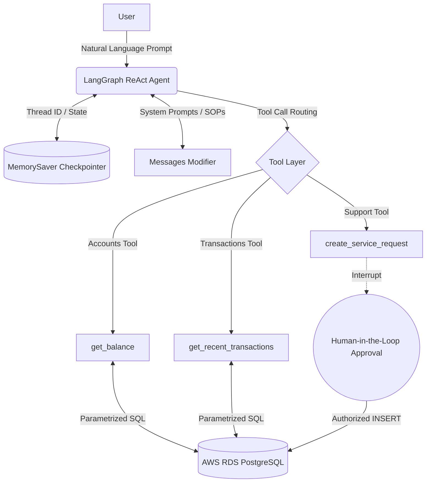

# 🏦 NexusBank AI: Autonomous Cloud-Connected Banking Agent


An enterprise-grade, stateful AI banking agent built with **LangGraph** and **Python**. Unlike standard chatbots that just answer FAQs, this agent autonomously routes user intent to execute dynamic, secure SQL queries against a live AWS cloud database. It features conversational memory, strict Standard Operating Procedures (SOPs), and built-in Human-in-the-Loop (HITL) safeguards for transactional write-operations.

---

## 🏗 System Architecture

The project follows a decoupled, microservice-inspired architecture separating the LLM reasoning loop from the database execution layer.



### 🧠 The Core Components

1. **The Brain (LLM Layer):** Utilizes LangGraph's `create_react_agent` to manage the conversation flow. The LLM (Nemotron via OpenRouter) evaluates its current context and decides which tools to invoke.
2. **The Memory (State Layer):** Implements LangGraph's `MemorySaver` using unique UUIDs. This provides session-based short-term memory, meaning users don't have to repeat their `account_id` in follow-up questions.
3. **The Body (Tool Layer):** Decoupled Python functions decorated with LangChain's `@tool`. Each tool is tightly scoped to a specific database domain (Accounts, Transactions, Support).
4. **The Infrastructure (Data Layer):** A live AWS RDS PostgreSQL database enforcing `sslmode=require`. Queries are heavily parameterized using `psycopg2` to eliminate SQL injection vulnerabilities.

---

## ✨ Granular Features

* **Intelligent Tool Routing:** The agent parses natural language and autonomously binds variables to Python functions. (e.g., mapping "How much did I spend at Whole Foods?" to `get_recent_transactions(account_id="...", limit=5)`).
* **Human-in-the-Loop (HITL) Safeguards:** Read operations (`SELECT`) happen instantly, but write operations (`INSERT`/`UPDATE`) physically pause the application thread. The agent cannot open a financial dispute without a human explicitly typing `y` in the terminal to authorize the database `commit()`.
* **Strict SOP Enforcement:** The agent is governed by a robust system prompt that acts as a corporate policy engine. For example, it is explicitly forbidden from opening a dispute ticket until it autonomously queries the database to verify the exact merchant name and transaction amount first.
* **Secure Cloud Integration:** Environment variables are strictly managed via `.env`. Database connections utilize Python context managers (`with get_db_connection():`) to ensure connections are efficiently opened and gracefully closed to prevent memory leaks.

---

## 📂 Project Structure

```text
banking-agent/
├── .env                    # Ignored: Contains AWS RDS URI and LLM API Keys
├── .gitignore              # Security definitions
├── agent.py                # Main LangGraph execution loop and CLI interface
├── requirements.txt        # Python package dependencies
└── src/
    ├── config/
    │   └── settings.py     # Centralized LLM factory and environment initialization
    ├── db/
    │   ├── database.py     # AWS psycopg2 connection manager & schema provisioning
    │   └── seed_transactions.py # Data injection script for testing ledger queries
    └── tools/
        ├── accounts.py     # Read-tool: SQL logic for balance and KYC lookups
        ├── transactions.py # Read-tool: SQL logic for historical ledger analysis
        └── support.py      # Write-tool: SQL logic for generating support tickets (HITL)

```

---

## 🚀 Getting Started (Local Setup)

### 1. Clone & Environment Setup

```bash
git clone https://github.com/YOUR-USERNAME/banking-agent.git
cd banking-agent
python3 -m venv venv
source venv/bin/activate
pip install -r requirements.txt
```

### 2. Configure Secrets

Create a `.env` file in the root directory and add your credentials:

```env
OPENROUTER_API_KEY="your_api_key_here"
AWS_DB_HOST="your-rds-endpoint.us-east-2.rds.amazonaws.com"
AWS_DB_NAME="postgres"
AWS_DB_USER="postgres"
AWS_DB_PASSWORD="your_secure_password"
AWS_DB_PORT="5432"
```

### 3. Provision the Database

Initialize the schema and inject mock data into your AWS instance:

```bash
python -m src.db.database
python -m src.db.seed_transactions
```

### 4. Run the Agent

Boot up the stateful LangGraph terminal loop:

```bash
python agent.py
```

---

## 🗺️ Roadmap & Future Scope

The project is actively transitioning from a local CLI interface to a scalable web microservice.

* [x] **Phase 1-3:** AWS Database Provisioning & Schema Design.
* [x] **Phase 4:** Decoupled MCP-Style Database Tools.
* [x] **Phase 5:** Agent Memory (Threaded Statefulness).
* [x] **Phase 6:** Action Tools with Terminal HITL.
* [ ] **Phase 7: Web Server Migration (FastAPI)** - Replacing the CLI loop with asynchronous REST endpoints (`/chat`, `/tools`) to handle concurrent web traffic.
* [ ] **Phase 8: Persistent Checkpointing** - Upgrading `MemorySaver` to `PostgresSaver` so the agent remembers user contexts across browser sessions.
* [ ] **Phase 9: API Security & Auth** - Implementing JWT token validation to automatically infer `user_id` from HTTP headers rather than relying on the LLM to ask for it.
* [ ] **Phase 10: Frontend UI** - Connecting the FastAPI backend to a modern React/Next.js interface.

---

*Disclaimer: This is an educational project demonstrating autonomous AI tool execution. Never use raw LLMs to process live financial transactions without rigorous deterministic guardrails and compliance reviews.*