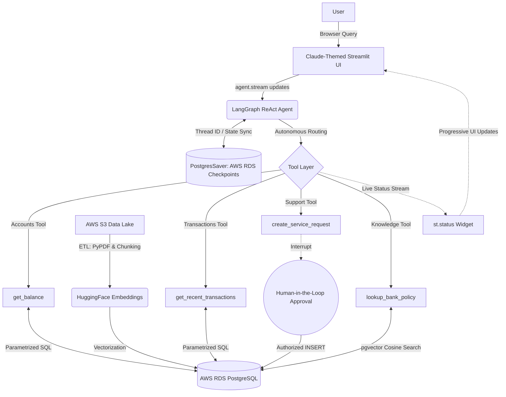

# 🏦 NexusBank AI: Autonomous Cloud-Connected Banking Agent


An enterprise-grade, stateful AI banking assistant built with **LangGraph**, **Python**, and **AWS Cloud Infrastructure**. Moving beyond standard stateless chatbots, this agent couples structured SQL lookups against live AWS RDS ledgers with unstructured Agentic RAG against an S3 regulatory data lake. 

The system features **persistent database checkpointing** (`PostgresSaver`) so session memory survives server restarts and browser reloads, an Anthropic Claude-inspired web interface, real-time streaming tool execution status widgets, and strict Human-in-the-Loop (HITL) dispute protocols.

---

## 🏗 System Architecture

The architecture decouples the web presentation tier, LLM reasoning engine, persistence checkpointer, database execution layer, and vector embedding pipeline.



### 🧠 The Core Components

1. **The Presentation Layer (Claude-Themed UI):** Built with Streamlit and styled via custom CSS to match Anthropic Claude's minimalist palette (`#FAF9F6` alabaster background, `#F0EFEA` left-aligned user bubbles, and soft borders). Powered by `agent.stream()` to pipe intermediate tool actions live to the user.
2. **The Memory (Persistent State Layer):** Powered by `langgraph-checkpoint-postgres` and backed by AWS RDS PostgreSQL using connection pooling (`psycopg_pool.ConnectionPool`). Conversation state, tool responses, and thread history persist directly across browser reloads, server reboots, and multi-worker instances.
3. **The Brain (LLM Orchestration):** Leverages LangGraph's ReAct architecture with Llama-3.1-Nemotron-70B (via OpenRouter). Governed by strict operational prompts, anti-loop rules, and a 50-step recursion threshold.
4. **The Knowledge Engine (Agentic RAG):** An automated ETL pipeline streams raw regulatory PDFs from an **AWS S3** bucket into memory, chunks them via `RecursiveCharacterTextSplitter`, embeds them using HuggingFace (`all-MiniLM-L6-v2`), and stores them in PostgreSQL using the `pgvector` extension for sub-second cosine-distance similarity lookups.
5. **The Ledger & Security (Data Layer):** Parameterized `psycopg2` SQL access running over encrypted SSL (`sslmode=require`) against AWS RDS PostgreSQL.

---

## ✨ Granular Features

* **Persistent AWS Checkpointing:** Threads are keyed to RDS via `PostgresSaver`. Users can refresh the page, switch session IDs via the sidebar, or revisit past threads without losing context or authentication state.
* **Real-Time Tool Execution Badges (`st.status`):** Replaced static loading spinners with live streaming updates. The UI dynamically displays when the agent executes `💳 Balance Inquiry`, `📊 Ledger Analysis`, `📚 S3 Policy Search`, or `📝 Service Request`.
* **Agentic S3-RAG:** The agent queries policies only when required, searching vector embeddings stored in RDS that link directly to PDFs residing in an AWS S3 bucket, citing explicit `s3://` URIs in its answers.
* **Anti-Loop Execution Safeguards:** Configured with a `recursion_limit` of 50 and system-level circuit breakers that cap repetitive RAG queries to prevent runaway execution costs.
* **Human-in-the-Loop (HITL) Dispute Protocol:** Write actions cannot complete until required merchant and transaction attributes are verified against the ledger and validated against regulatory dispute timelines.

---

## 📂 Project Structure

```text
banking-agent/
├── .streamlit/
│   └── config.toml          # Claude-themed UI palette definitions
├── data/
│   └── banking_corpus/      # Local staging for downloaded regulatory PDFs
├── src/
│   ├── config/
│   │   └── settings.py      # LLM factory and OpenRouter configuration
│   ├── db/
│   │   ├── database.py      # AWS RDS connection manager & schema init
│   │   ├── init_checkpointer.py # Migration: Provisions LangGraph RDS tables
│   │   ├── seed_realistic.py# Data injection for mock transaction ledgers
│   │   ├── download_corpus.py# Automated downloader for compliance manuals
│   │   ├── upload_to_s3.py  # Pushes raw PDFs to AWS S3 Data Lake
│   │   └── seed_from_s3.py  # ETL: Streams S3 -> Embeds -> pgvector
│   └── tools/
│       ├── accounts.py      # get_balance tool
│       ├── transactions.py  # get_recent_transactions tool
│       ├── support.py       # create_service_request tool (HITL)
│       └── knowledge.py     # lookup_bank_policy tool (pgvector)
├── .env                     # Secrets: AWS RDS, S3, and LLM API Keys
├── agent.py                 # Core LangGraph agent with PostgresSaver
├── app.py                   # Claude-themed Streamlit UI with streaming
└── requirements.txt         # Project dependencies

```

---

## 🚀 Getting Started (Local Setup)

### 1. Clone & Environment Setup

```bash
git clone https://github.com/YOUR-USERNAME/banking-agent.git
cd banking-agent
python3 -m venv venv
source venv/bin/activate
pip install -r requirements.txt

```

### 2. Configure Secrets

Create a `.env` file in the project root:

```env
OPENROUTER_API_KEY="your_api_key_here"

# AWS RDS PostgreSQL Configuration
AWS_DB_HOST="your-rds-endpoint.us-east-2.rds.amazonaws.com"
AWS_DB_NAME="postgres"
AWS_DB_USER="postgres"
AWS_DB_PASSWORD="your_secure_password"
AWS_DB_PORT="5432"

# AWS S3 Data Lake Configuration
AWS_ACCESS_KEY_ID="your_aws_access_key_id"
AWS_SECRET_ACCESS_KEY="your_aws_secret_access_key"
AWS_REGION="us-east-2"
AWS_S3_BUCKET_NAME="banking-agent-bot"

```

### 3. Initialize Schemas, Checkpoints & S3 Pipeline

Run the setup scripts in sequence:

```bash
# 1. Initialize core banking tables
python -m src.db.database

# 2. Provision LangGraph persistent checkpoint tables in AWS RDS
python -m src.db.init_checkpointer

# 3. Inject realistic categorized transaction history
python -m src.db.seed_realistic

# 4. Fetch regulatory PDF manuals
python -m src.db.download_corpus

# 5. Push manuals to AWS S3 Data Lake
python -m src.db.upload_to_s3

# 6. Stream from S3, embed, and index into pgvector
python -m src.db.seed_from_s3

```

### 4. Run the Application

You can launch the agent either through the web interface or the terminal CLI:

**Web UI (Claude-Themed Streamlit App):**

```bash
streamlit run app.py

```

**Terminal CLI:**

```bash
python agent.py

```

---

## 🗺️ Roadmap & Future Scope

The project has transitioned from a local CLI into a stateful, cloud-backed web application.

* [x] **Phase 1-3:** AWS Database Provisioning & Schema Design.
* [x] **Phase 4:** Decoupled MCP-Style Database Tools.
* [x] **Phase 5:** Agent Memory (Threaded Statefulness).
* [x] **Phase 6:** Agentic RAG, S3 Data Lake, and `pgvector` Integration.
* [x] **Phase 7:** Claude-Themed Web Interface with Real-Time Tool Streaming (`st.status`).
* [x] **Phase 8:** Persistent AWS RDS Checkpointing (`PostgresSaver` via `psycopg_pool`).
* [ ] **Phase 9: In-App Web HITL Approvals** - Replacing terminal prompts with native Streamlit action buttons via LangGraph `interrupt()` and `Command(resume=...)`.
* [ ] **Phase 10: FastAPI Microservice Migration** - Exposing REST and WebSocket endpoints (`/chat`, `/history`, `/approve`) to decouple backend execution from the UI.
* [ ] **Phase 11: Enterprise Auth & Scoping** - Integrating JWT validation to extract customer identity directly from headers rather than conversational prompts.

---

*Disclaimer: This is an educational and reference implementation demonstrating autonomous cloud-native AI agents. Live financial systems require rigorous determinism, automated red-teaming, and compliance review.*